# Screenshots

Rendered from the running application (headless, 1300×840).

## All sections — Midnight Purple (default theme)

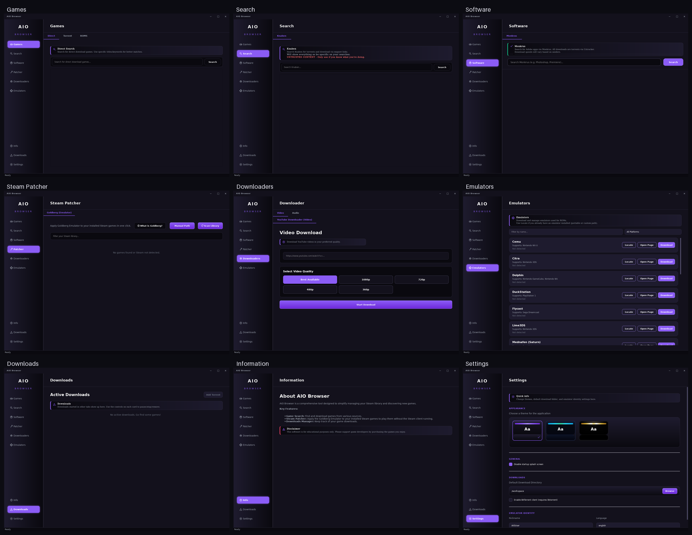

## Themes

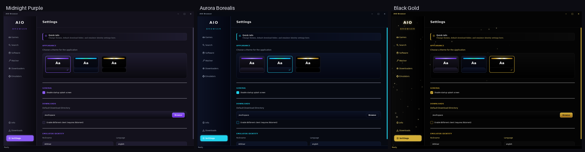

## Individual tabs (default theme)

| Section | Preview |
| --- | --- |
| Games | 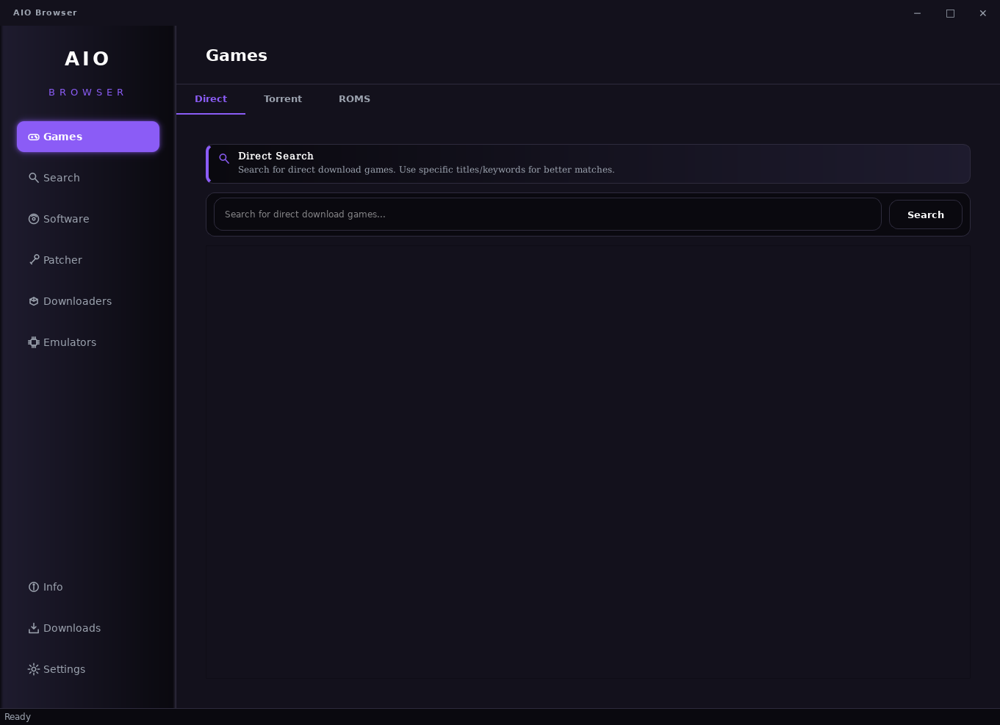 |
| Search | 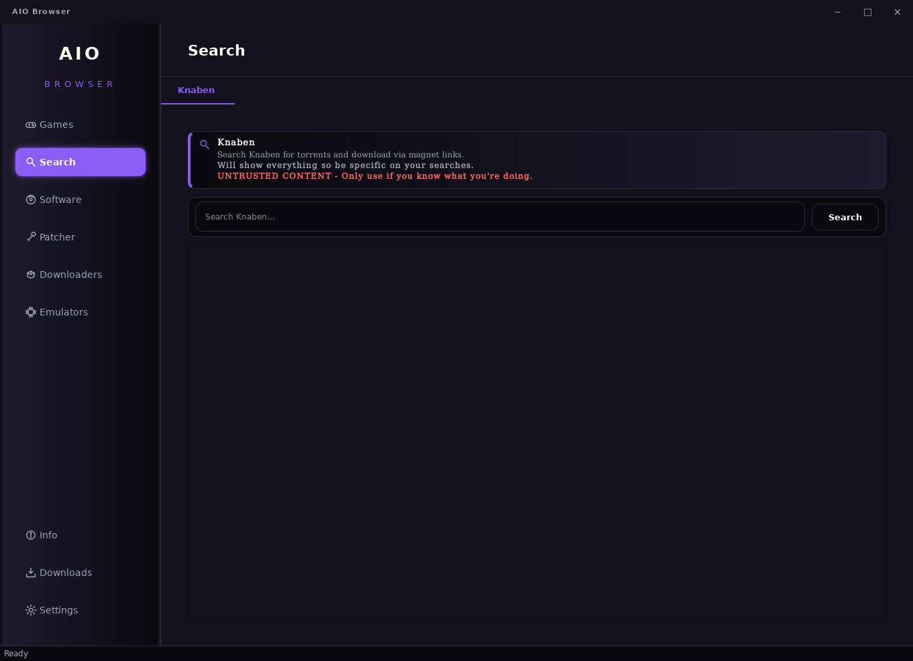 |
| Software | 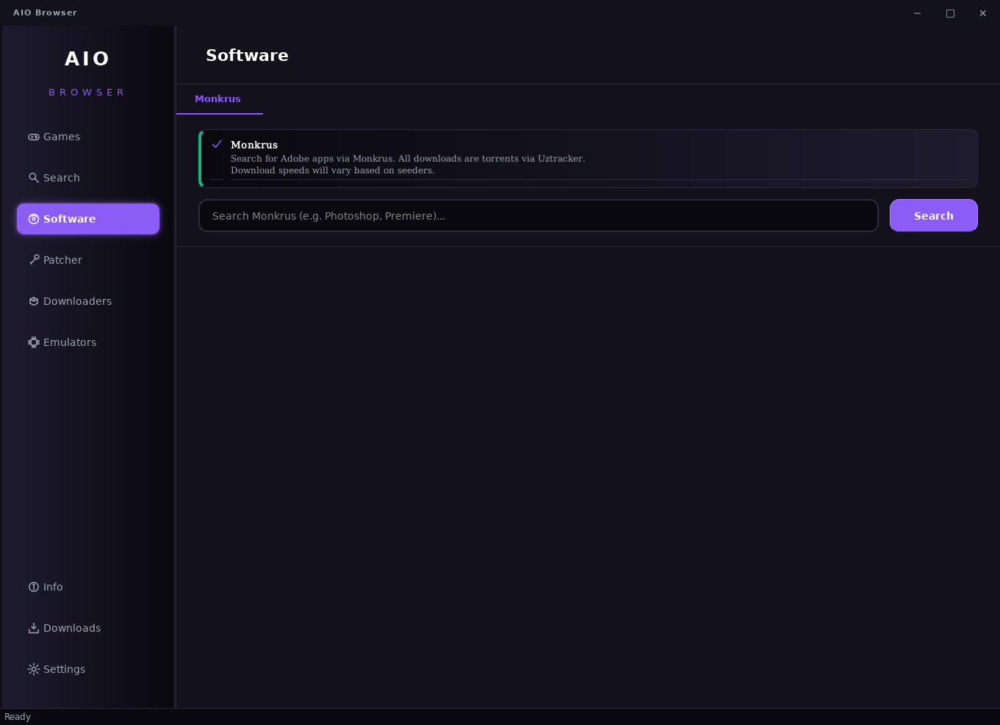 |
| Steam Patcher | 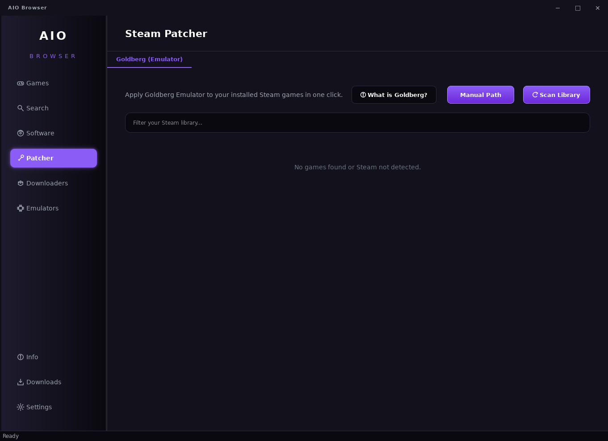 |
| Downloaders | 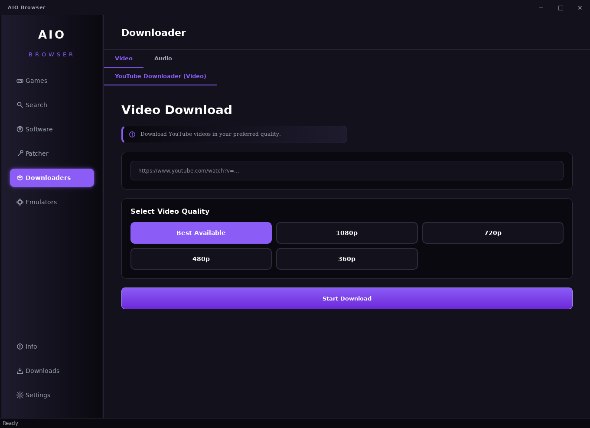 |
| Emulators | 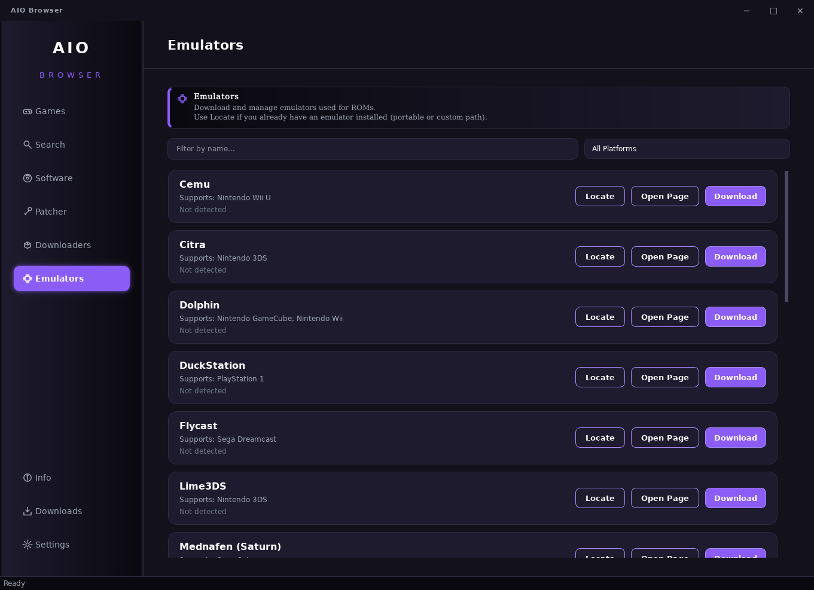 |
| Downloads | 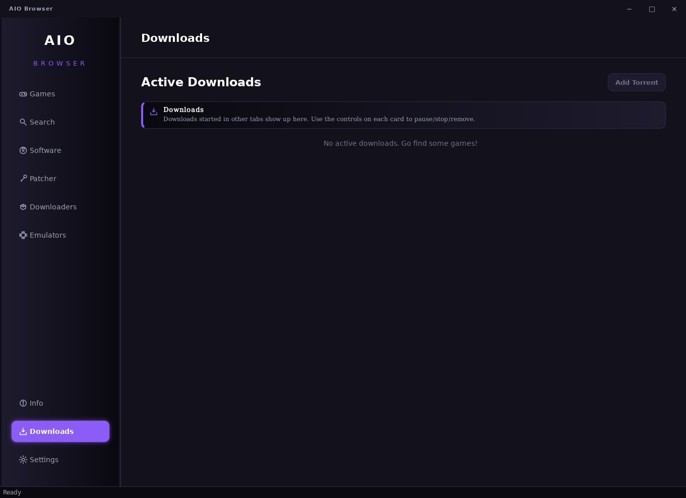 |
| Information | 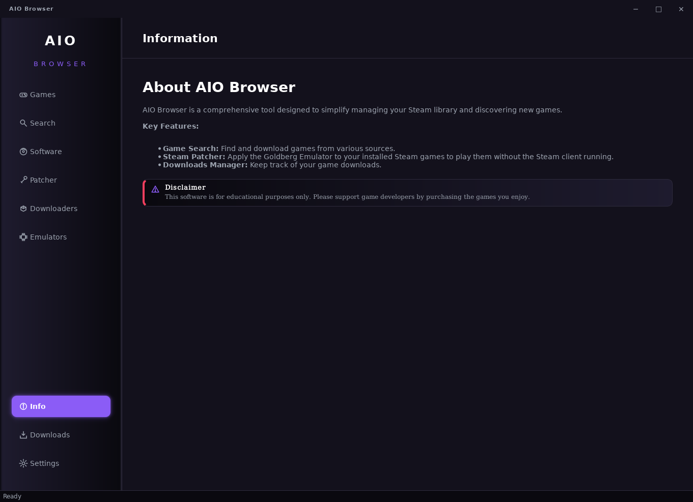 |
| Settings | 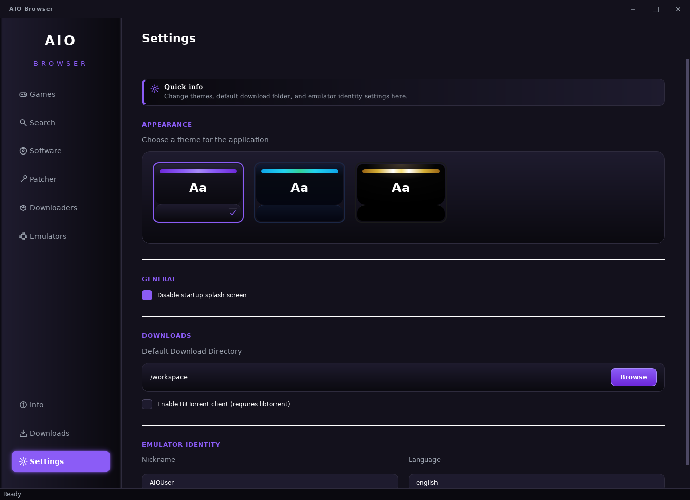 |

> These PNGs were generated with `tools/render_ui.py`; regenerate them any time
> the UI changes.
